# ScamAlert — Entity Relationship Diagram

> 20 tables, 28 foreign key relationships. Render this file in GitHub, VS Code (Mermaid extension), or any Mermaid-compatible viewer.
> Note: table/relationship structure matches the frozen `sql/01_schema.sql`; a few column *names* below use the original design wording (`users.display_name` → `name`, `password_hash` → `password`, `is_email_verified` → `emailVerified`, plus a `better_auth_id` column). When in doubt, the SQL file is authoritative.

```mermaid
erDiagram

    users {
        BINARY id PK "UUIDv7"
        VARCHAR email UK "UNIQUE, NOT NULL"
        VARCHAR display_name "NOT NULL"
        VARCHAR password_hash
        ENUM role "user|trusted_hunter|moderator|admin"
        BOOLEAN is_email_verified
        BOOLEAN is_active
        INT reputation_score
        VARCHAR reputation_tier
        INT total_reports
        INT verified_reports
        INT total_votes_cast
        INT accurate_votes
        DATETIME last_active_date
        TIMESTAMP created_at
        TIMESTAMP updated_at
    }

    categories {
        BINARY id PK "UUIDv7"
        VARCHAR name UK "UNIQUE, NOT NULL"
        VARCHAR slug UK "UNIQUE, NOT NULL"
        TEXT description
        DECIMAL severity_weight "NOT NULL, DEFAULT 1.00"
        VARCHAR icon
        INT display_order
        BOOLEAN is_active
    }

    website_urls {
        BINARY id PK "UUIDv7"
        TEXT normalized_url UK "UNIQUE, NOT NULL"
        TEXT raw_url "NOT NULL"
        VARCHAR domain "NOT NULL, indexed"
        VARCHAR subdomain
        VARCHAR registrar
        DATE registration_date
        DATE expiration_date
        JSON whois_data
        TIMESTAMP whois_fetched_at
        BOOLEAN ssl_valid
        VARCHAR ssl_issuer
        TIMESTAMP ssl_expiry_date
        BOOLEAN dmarc_exists
        BOOLEAN spf_exists
        INT blacklist_matches
        BOOLEAN is_active
        TIMESTAMP first_reported_at
        TIMESTAMP last_reported_at
        INT total_reports
        INT confirmed_reports
        INT active_reports
        DECIMAL risk_score
        VARCHAR risk_level
    }

    fraud_reports {
        BINARY id PK "UUIDv7"
        BINARY reporter_id FK "NOT NULL"
        BINARY website_url_id FK "NOT NULL"
        BINARY category_id FK "NOT NULL"
        VARCHAR title "NOT NULL, FULLTEXT"
        TEXT description "NOT NULL, FULLTEXT"
        VARCHAR target_brand
        DECIMAL amount_lost
        CHAR currency "DEFAULT 'INR'"
        DATE incident_date
        CHAR country_code
        ENUM status "active|archived|disputed|rejected|duplicate"
        ENUM verification_stage "reported|under_review|multiple_reports|community_verified|confirmed_malicious"
        BOOLEAN is_anonymous
        BINARY is_duplicate_of FK "self-ref"
        INT confirm_votes
        INT deny_votes
        INT total_votes
        VARCHAR slug
        TIMESTAMP created_at
        TIMESTAMP updated_at
        TIMESTAMP resolved_at
    }

    report_evidence {
        BINARY id PK "UUIDv7"
        BINARY report_id FK "NOT NULL"
        BINARY uploaded_by FK "NOT NULL"
        ENUM evidence_type "screenshot|email_file|text_message|document|video|audio|url_archive|other"
        VARCHAR file_name "NOT NULL"
        TEXT file_path "NOT NULL"
        VARCHAR mime_type "NOT NULL"
        BIGINT file_size_bytes "NOT NULL"
        VARCHAR sha256_hash "NOT NULL"
        INT width
        INT height
        TEXT description
        BOOLEAN is_approved
        TIMESTAMP uploaded_at
    }

    verification_votes {
        BINARY id PK "UUIDv7"
        BINARY report_id FK "NOT NULL"
        BINARY voter_id FK "NOT NULL"
        ENUM vote_type "confirm|deny|inconclusive"
        DECIMAL confidence "DEFAULT 1.00"
        TEXT comment
        INT voter_reputation_at_vote
        TIMESTAMP created_at
    }

    tags {
        BINARY id PK "UUIDv7"
        VARCHAR name UK "UNIQUE, NOT NULL"
        VARCHAR slug UK "UNIQUE, NOT NULL"
        TIMESTAMP created_at
    }

    report_tags {
        BINARY report_id FK "PK, NOT NULL"
        BINARY tag_id FK "PK, NOT NULL"
    }

    report_comments {
        BINARY id PK "UUIDv7"
        BINARY report_id FK "NOT NULL"
        BINARY user_id FK "NOT NULL"
        BINARY parent_id FK "self-ref"
        TEXT body "NOT NULL"
        BOOLEAN is_deleted
        TIMESTAMP created_at
    }

    report_history {
        BINARY id PK "UUIDv7"
        BINARY report_id FK "NOT NULL"
        BINARY actor_id FK "NULL for system"
        ENUM action "created|updated|status_changed|vote_added|evidence_uploaded|appeal_filed|resolved"
        JSON old_value
        JSON new_value
        TIMESTAMP created_at
    }

    risk_score_breakdowns {
        BINARY id PK "UUIDv7"
        BINARY website_url_id FK "NOT NULL"
        DECIMAL community_sub_score
        DECIMAL automated_sub_score
        DECIMAL category_severity_avg
        DECIMAL final_score
        JSON signals
        TIMESTAMP calculated_at
    }

    appeals {
        BINARY id PK "UUIDv7"
        BINARY report_id FK "NOT NULL"
        VARCHAR appellant_email "NOT NULL"
        BOOLEAN domain_owner_verified
        ENUM status "pending|under_review|upheld|overturned|partially_upheld|rejected"
        TEXT reason "NOT NULL"
        TIMESTAMP submitted_at
        TIMESTAMP resolved_at
        BINARY resolved_by FK "NULL for system"
    }

    appeal_evidence {
        BINARY id PK "UUIDv7"
        BINARY appeal_id FK "NOT NULL"
        ENUM evidence_type "business_registration|dns_verification|html_verification|legal_document|other"
        TEXT file_path "NOT NULL"
        VARCHAR sha256_hash "NOT NULL"
        TEXT description
        TIMESTAMP uploaded_at
    }

    reputation_events {
        BINARY id PK "UUIDv7"
        BINARY user_id FK "NOT NULL"
        INT delta "signed change +/-"
        ENUM reason "report_confirmed|report_denied|vote_accurate|vote_inaccurate|report_resolved|penalty|decay|manual_adjustment"
        BINARY reference_id "optional FK"
        TIMESTAMP created_at
    }

    rate_limit_events {
        BINARY id PK "UUIDv7"
        BINARY user_id FK "NULL for IP-based"
        VARCHAR ip_address "IPv4 or IPv6"
        VARCHAR action_type "NOT NULL"
        TIMESTAMP created_at
    }

    audit_events {
        BINARY id PK "UUIDv7"
        BINARY actor_id FK "NULL for system"
        VARCHAR action "NOT NULL"
        VARCHAR entity_type "NOT NULL"
        BINARY entity_id "NOT NULL"
        JSON metadata
        VARCHAR ip_address
        TIMESTAMP created_at
    }

    platform_config {
        VARCHAR key PK "NOT NULL"
        JSON value "NOT NULL"
        TEXT description
        TIMESTAMP updated_at
    }

    website_discussions {
        BINARY id PK "UUIDv7"
        BINARY website_url_id FK "NOT NULL"
        BINARY author_id FK "NOT NULL"
        VARCHAR title "NOT NULL"
        TEXT body "NOT NULL"
        BOOLEAN is_pinned
        BOOLEAN is_locked
        BOOLEAN is_deleted
        INT upvotes
        INT downvotes
        INT reply_count
        TIMESTAMP last_activity_at
        TIMESTAMP created_at
        TIMESTAMP updated_at
    }

    discussion_replies {
        BINARY id PK "UUIDv7"
        BINARY discussion_id FK "NOT NULL"
        BINARY author_id FK "NOT NULL"
        BINARY parent_id FK "self-ref, NULL = top-level"
        TEXT body "NOT NULL"
        BOOLEAN is_deleted
        INT upvotes
        INT downvotes
        INT depth "max 5 levels"
        TIMESTAMP created_at
        TIMESTAMP updated_at
    }

    discussion_votes {
        BINARY id PK "UUIDv7"
        BINARY user_id FK "NOT NULL"
        ENUM target_type "discussion|reply"
        BINARY target_id FK "NOT NULL"
        TINYINT vote_value "-1 or +1"
        TIMESTAMP created_at
    }

    %% ── Core relationships ──
    users ||--o{ fraud_reports : "submits"
    categories ||--o{ fraud_reports : "categorizes"
    website_urls ||--o{ fraud_reports : "targets"
    fraud_reports ||--o{ fraud_reports : "is_duplicate_of"

    %% ── Evidence ──
    fraud_reports ||--o{ report_evidence : "has"
    users ||--o{ report_evidence : "uploads"

    %% ── Votes ──
    fraud_reports ||--o{ verification_votes : "receives"
    users ||--o{ verification_votes : "casts"

    %% ── Tags (many-to-many) ──
    fraud_reports ||--o{ report_tags : "tagged_with"
    tags ||--o{ report_tags : "applied_to"

    %% ── Comments (self-referential) ──
    fraud_reports ||--o{ report_comments : "discusses"
    users ||--o{ report_comments : "writes"
    report_comments ||--o{ report_comments : "replies_to"

    %% ── Audit trail ──
    fraud_reports ||--o{ report_history : "tracked_by"
    users ||--o{ report_history : "acts_on"

    %% ── Risk scoring ──
    website_urls ||--o{ risk_score_breakdowns : "scored_by"

    %% ── Appeals ──
    fraud_reports ||--o{ appeals : "disputed_via"
    users ||--o{ appeals : "resolves"
    appeals ||--o{ appeal_evidence : "supported_by"

    %% ── Reputation ──
    users ||--o{ reputation_events : "earns"

    %% ── Rate limiting ──
    users ||--o{ rate_limit_events : "limited_by"

    %% ── Global audit ──
    users ||--o{ audit_events : "audited_by"

    %% ── Forum ──
    website_urls ||--o{ website_discussions : "discussed_in"
    users ||--o{ website_discussions : "creates"
    website_discussions ||--o{ discussion_replies : "receives"
    users ||--o{ discussion_replies : "writes"
    discussion_replies ||--o{ discussion_replies : "replies_to"
    users ||--o{ discussion_votes : "votes_with"
```

## Relationship Summary

| # | Parent | Child | FK Column | Type |
|---|--------|-------|-----------|------|
| 1 | users | fraud_reports | reporter_id | 1:N |
| 2 | categories | fraud_reports | category_id | 1:N |
| 3 | website_urls | fraud_reports | website_url_id | 1:N |
| 4 | fraud_reports | fraud_reports | is_duplicate_of | self-ref |
| 5 | fraud_reports | report_evidence | report_id | 1:N |
| 6 | users | report_evidence | uploaded_by | 1:N |
| 7 | fraud_reports | verification_votes | report_id | 1:N |
| 8 | users | verification_votes | voter_id | 1:N |
| 9 | fraud_reports | report_tags | report_id | 1:N |
| 10 | tags | report_tags | tag_id | 1:N |
| 11 | fraud_reports | report_comments | report_id | 1:N |
| 12 | users | report_comments | user_id | 1:N |
| 13 | report_comments | report_comments | parent_id | self-ref |
| 14 | fraud_reports | report_history | report_id | 1:N |
| 15 | users | report_history | actor_id | 1:N |
| 16 | website_urls | risk_score_breakdowns | website_url_id | 1:N |
| 17 | fraud_reports | appeals | report_id | 1:N |
| 18 | users | appeals | resolved_by | 1:N |
| 19 | appeals | appeal_evidence | appeal_id | 1:N |
| 20 | users | reputation_events | user_id | 1:N |
| 21 | users | rate_limit_events | user_id | 1:N |
| 22 | users | audit_events | actor_id | 1:N |
| 23 | website_urls | website_discussions | website_url_id | 1:N |
| 24 | users | website_discussions | author_id | 1:N |
| 25 | website_discussions | discussion_replies | discussion_id | 1:N |
| 26 | users | discussion_replies | author_id | 1:N |
| 27 | discussion_replies | discussion_replies | parent_id | self-ref |
| 28 | users | discussion_votes | user_id | 1:N |

**Total: 28 foreign key relationships across 20 tables**
